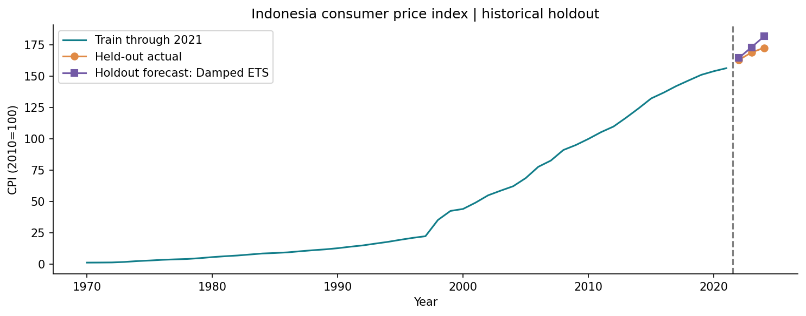

# Forecasting Indonesian CPI with Statistical and Machine Learning Models

**Wawan Saputra | Independent Portfolio Project | 2026 | Project 2/8**

## Overview
Project terimplementasi dengan data publik, kode analisis yang dapat dijalankan, notebook, tabel dan grafik hasil eksekusi aktual. Tidak menggunakan hasil numerik sintetis.

## Research / Business Question
Bagaimana performa ARIMA, exponential smoothing dan benchmark machine learning dalam meramalkan CPI tahunan Indonesia?

## Dataset
World Bank / IMF CPI Indonesia, indikator FP.CPI.TOTL (2010=100), 1970–2024; 55 observasi tahunan.

Sumber: [dokumentasi sumber](https://data.worldbank.org/indicator/FP.CPI.TOTL?locations=ID). URL unduhan, waktu pengambilan UTC, ukuran dan SHA-256 tersedia pada `data/source_manifest.json`. Snapshot sumber disimpan di `data/raw/`, sehingga rerun analisis menggunakan data yang sama. Atribusi dan batas penggunaan tercantum di [THIRD_PARTY_DATA.md](THIRD_PARTY_DATA.md).

## Methods
Naive, log drift, ARIMA(1,1,1) dengan drift, damped ETS, recursive Random Forest pada lag log-growth; expanding rolling-origin validation; MAE/RMSE/MAPE; ADF, ACF/PACF dan residual Ljung–Box.

## Scope and Assumptions
Data tahunan tidak mendukung identifikasi musim dalam satu tahun. Karena itu SARIMA musiman dan seasonal decomposition tidak dipaksakan; tersedia dekomposisi trend/remainder deskriptif. Cutoff tetap 2024; forecast 2025–2027 merupakan eksperimen retrospektif, bukan ramalan terkini.

## Workflow
1. Baca atau unduh snapshot sumber; verifikasi checksum dan validasi data.
2. Bentuk dataset analisis dengan aturan yang terdokumentasi.
3. Jalankan metode statistik/model sesuai desain studi.
4. Simpan hasil, diagnostik, visualisasi dan ringkasan interpretasi.

## Key Results and Interpretation
Lihat [executive summary](outputs/executive_summary.md) untuk hasil aktual, interpretasi, rekomendasi, limitations, dan dua bullet CV. Hasil terstruktur tersedia di [metrics.json](outputs/metrics.json), dengan tabel pendukung di `outputs/tables/`. Angka README tidak digandakan agar tidak tertinggal dari hasil rerun.

## Visualizations


## Reproducibility
Python 3.11 diuji. Jalankan perintah berikut dari folder project. `requirements-lock.txt` mencatat versi paket yang benar-benar digunakan; `requirements.txt` adalah daftar dependensi langsung. Gunakan environment terpisah untuk setiap project.

```powershell
python -m venv .venv
.\.venv\Scripts\python.exe -m pip install -r requirements-lock.txt
.\.venv\Scripts\python.exe -m src.run
.\.venv\Scripts\python.exe -m unittest discover -s tests -v
```


Untuk membuka notebook: instal `jupyterlab ipykernel`, lalu `python -m jupyterlab`. Notebook EDA, modeling dan reporting membaca snapshot/hasil yang disimpan. Notebook modeling menjelaskan dan menyediakan perintah rerun analisis; tidak melatih ulang secara tersembunyi ketika sekadar melihat hasil. Seluruh notebook telah dieksekusi untuk pemeriksaan.

## Repository Structure
```text
time-series-forecasting/
├── README.md
├── THIRD_PARTY_DATA.md
├── data/                 # raw, processed, source manifest
├── notebooks/            # EDA, modeling, interpretation
├── src/                  # reusable analysis functions and CLI
├── tests/                # meaningful integrity and statistical checks
├── outputs/
│   ├── figures/
│   ├── tables/
│   ├── metrics.json
│   ├── environment.json
│   └── executive_summary.md
├── requirements.txt
└── requirements-lock.txt
```

## Limitations and Future Work
Data tahunan tidak mendukung identifikasi musim dalam satu tahun. Karena itu SARIMA musiman dan seasonal decomposition tidak dipaksakan; tersedia dekomposisi trend/remainder deskriptif. Cutoff tetap 2024; forecast 2025–2027 merupakan eksperimen retrospektif, bukan ramalan terkini.

Batasan spesifik dan rencana pengembangan dibahas dalam executive summary. Hasil adalah portfolio riset terapan yang bergantung pada dataset dan asumsi; tidak menggantikan validasi lapangan atau penerapan produksi.

## Author
Wawan Saputra
